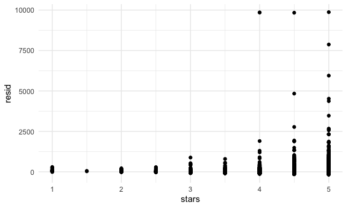
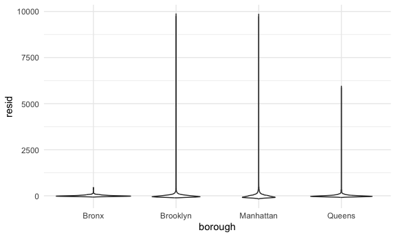
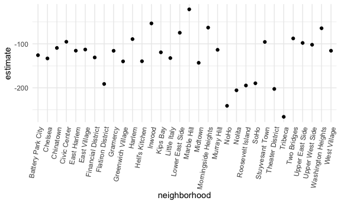

Linear Models
================

``` r
library(tidyverse)
library(p8105.datasets)

set.seed(1)
```

``` r
knitr::opts_chunk$set(
  fig.width = 6,
  fig.asp = .6,
  out.width = "90%"
)

theme_set(theme_minimal() + theme(legend.position = "bottom"))

options(
  ggplot2.continuous.colour = "viridis",
  ggplot2.continuous.fill = "viridis"
)

scale_colour_discrete = scale_colour_viridis_d
scale_fill_discrete = scale_fill_viridis_d
```

``` r
data("nyc_airbnb")

nyc_airbnb = 
  nyc_airbnb |>
  mutate(
    stars = review_scores_location / 2
  ) |>
  rename(
    borough = neighbourhood_group,
    neighborhood = neighbourhood
  ) |>
  filter(
    borough != "Staten Island"
  ) |>
  select(price, stars, borough, neighborhood, room_type)
```

Fit a linear regression

``` r
fit = lm(price ~ stars + borough, data = nyc_airbnb)
```

Look at what we have

most of this output is not so readable, let’s do better

``` r
broom::tidy(fit) |>
  select(-std.error) |>
  knitr::kable(digits = 3)
```

| term             | estimate | statistic | p.value |
|:-----------------|---------:|----------:|--------:|
| (Intercept)      |  -70.414 |    -5.022 |   0.000 |
| stars            |   31.990 |    12.657 |   0.000 |
| boroughBrooklyn  |   40.500 |     4.732 |   0.000 |
| boroughManhattan |   90.254 |    10.534 |   0.000 |
| boroughQueens    |   13.206 |     1.457 |   0.145 |

``` r
broom::glance(fit)
```

    ## # A tibble: 1 × 12
    ##   r.squared adj.r.squared sigma statistic   p.value    df   logLik    AIC    BIC
    ##       <dbl>         <dbl> <dbl>     <dbl>     <dbl> <dbl>    <dbl>  <dbl>  <dbl>
    ## 1    0.0342        0.0341  182.      271. 6.73e-229     4 -202113. 4.04e5 4.04e5
    ## # ℹ 3 more variables: deviance <dbl>, df.residual <int>, nobs <int>

change reference category

``` r
fit =
  nyc_airbnb |>
  mutate(
    borough = fct_infreq(borough)
  ) |>
  lm(price ~ stars + borough, data = _)

broom::tidy(fit) |>
  select(-std.error, -statistic) |>
  mutate(term = str_replace(term, "borough", "Borough: ")) |>
  knitr::kable(digits = 3)
```

| term              | estimate | p.value |
|:------------------|---------:|--------:|
| (Intercept)       |   19.839 |   0.104 |
| stars             |   31.990 |   0.000 |
| Borough: Brooklyn |  -49.754 |   0.000 |
| Borough: Queens   |  -77.048 |   0.000 |
| Borough: Bronx    |  -90.254 |   0.000 |

## Diagnostics

Basically looking at the residuals

``` r
modelr::add_residuals(nyc_airbnb, fit)
```

    ## # A tibble: 40,492 × 6
    ##    price stars borough neighborhood room_type        resid
    ##    <dbl> <dbl> <chr>   <chr>        <chr>            <dbl>
    ##  1    99   5   Bronx   City Island  Private room      9.47
    ##  2   200  NA   Bronx   City Island  Private room     NA   
    ##  3   300  NA   Bronx   City Island  Entire home/apt  NA   
    ##  4   125   5   Bronx   City Island  Entire home/apt  35.5 
    ##  5    69   5   Bronx   City Island  Private room    -20.5 
    ##  6   125   5   Bronx   City Island  Entire home/apt  35.5 
    ##  7    85   5   Bronx   City Island  Entire home/apt  -4.53
    ##  8    39   4.5 Bronx   Allerton     Private room    -34.5 
    ##  9    95   5   Bronx   Allerton     Entire home/apt   5.47
    ## 10   125   4.5 Bronx   Allerton     Entire home/apt  51.5 
    ## # ℹ 40,482 more rows

Okay more looking

``` r
nyc_airbnb |>
  modelr::add_residuals(fit) |>
  ggplot(aes(x = stars, y = resid)) +
  geom_point()
```

    ## Warning: Removed 9962 rows containing missing values or values outside the scale range
    ## (`geom_point()`).



``` r
nyc_airbnb |>
  modelr::add_residuals(fit) |>
  ggplot(aes(x = borough, y = resid)) +
  geom_violin()
```

    ## Warning: Removed 9962 rows containing non-finite outside the scale range
    ## (`stat_ydensity()`).



## Hypothesis testing

Single

``` r
broom::tidy(fit) |>
  mutate(term = str_replace(term, "borough", "Borough: ")) |>
  knitr::kable(digits = 3)
```

| term              | estimate | std.error | statistic | p.value |
|:------------------|---------:|----------:|----------:|--------:|
| (Intercept)       |   19.839 |    12.189 |     1.628 |   0.104 |
| stars             |   31.990 |     2.527 |    12.657 |   0.000 |
| Borough: Brooklyn |  -49.754 |     2.235 |   -22.262 |   0.000 |
| Borough: Queens   |  -77.048 |     3.727 |   -20.675 |   0.000 |
| Borough: Bronx    |  -90.254 |     8.567 |   -10.534 |   0.000 |

Try testing nested models

``` r
fit_null = lm(price ~ stars, data = nyc_airbnb)
fit_alt = lm(price ~ stars + borough, data = nyc_airbnb)

anova(fit_null, fit_alt)
```

    ## Analysis of Variance Table
    ## 
    ## Model 1: price ~ stars
    ## Model 2: price ~ stars + borough
    ##   Res.Df        RSS Df Sum of Sq      F    Pr(>F)    
    ## 1  30528 1030861841                                  
    ## 2  30525 1005601724  3  25260117 255.59 < 2.2e-16 ***
    ## ---
    ## Signif. codes:  0 '***' 0.001 '**' 0.01 '*' 0.05 '.' 0.1 ' ' 1

## Nesting data

Try a more complicated model

`*` = checking if there’s an interaction

``` r
nyc_airbnb |>
  lm(price ~ stars * borough + room_type * borough, data = _) |>
  broom::tidy() |>
  knitr::kable(digits = 3)
```

| term                                   | estimate | std.error | statistic | p.value |
|:---------------------------------------|---------:|----------:|----------:|--------:|
| (Intercept)                            |   90.067 |    75.406 |     1.194 |   0.232 |
| stars                                  |    4.446 |    16.633 |     0.267 |   0.789 |
| boroughBrooklyn                        |  -20.439 |    77.117 |    -0.265 |   0.791 |
| boroughManhattan                       |    5.627 |    77.808 |     0.072 |   0.942 |
| boroughQueens                          |    1.509 |    83.501 |     0.018 |   0.986 |
| room_typePrivate room                  |  -52.915 |    17.751 |    -2.981 |   0.003 |
| room_typeShared room                   |  -70.547 |    41.551 |    -1.698 |   0.090 |
| stars:boroughBrooklyn                  |   16.525 |    16.982 |     0.973 |   0.331 |
| stars:boroughManhattan                 |   22.664 |    17.099 |     1.325 |   0.185 |
| stars:boroughQueens                    |    5.208 |    18.272 |     0.285 |   0.776 |
| boroughBrooklyn:room_typePrivate room  |  -39.308 |    18.024 |    -2.181 |   0.029 |
| boroughManhattan:room_typePrivate room |  -71.273 |    18.002 |    -3.959 |   0.000 |
| boroughQueens:room_typePrivate room    |  -16.341 |    19.020 |    -0.859 |   0.390 |
| boroughBrooklyn:room_typeShared room   |  -35.292 |    42.942 |    -0.822 |   0.411 |
| boroughManhattan:room_typeShared room  |  -83.089 |    42.451 |    -1.957 |   0.050 |
| boroughQueens:room_typeShared room     |  -24.427 |    44.399 |    -0.550 |   0.582 |

What if I want to know what’s happening in manhattan?

``` r
nyc_airbnb |>
  filter(borough == "Manhattan") |>
  lm(price ~ stars + room_type, data = _) |>
  broom::tidy()
```

    ## # A tibble: 4 × 5
    ##   term                  estimate std.error statistic   p.value
    ##   <chr>                    <dbl>     <dbl>     <dbl>     <dbl>
    ## 1 (Intercept)               95.7     22.2       4.31 1.62e-  5
    ## 2 stars                     27.1      4.59      5.91 3.45e-  9
    ## 3 room_typePrivate room   -124.       3.46    -35.8  9.40e-270
    ## 4 room_typeShared room    -154.      10.1     -15.3  2.47e- 52

``` r
nyc_airbnb |>
  filter(borough == "Bronx") |>
  lm(price ~ stars + room_type, data = _) |>
  broom::tidy()
```

    ## # A tibble: 4 × 5
    ##   term                  estimate std.error statistic  p.value
    ##   <chr>                    <dbl>     <dbl>     <dbl>    <dbl>
    ## 1 (Intercept)              90.1      15.2       5.94 5.73e- 9
    ## 2 stars                     4.45      3.35      1.33 1.85e- 1
    ## 3 room_typePrivate room   -52.9       3.57    -14.8  6.21e-41
    ## 4 room_typeShared room    -70.5       8.36     -8.44 4.16e-16

Let’s fix this with iteration

``` r
airbnb_lm = function(data) {
  
    lm(price ~ stars + room_type, data = data)

}
```

``` r
nyc_airbnb |>
  nest(datasets = -borough) |>
  mutate(
    fits = map(datasets, airbnb_lm),
    results = map(fits, broom::tidy)
  ) |>
  select(-datasets, -fits) |>
  unnest(results) |>
  select(borough, term, estimate) |>
  pivot_wider(
    names_from = term,
    values_from = estimate
  )
```

    ## # A tibble: 4 × 5
    ##   borough   `(Intercept)` stars `room_typePrivate room` `room_typeShared room`
    ##   <chr>             <dbl> <dbl>                   <dbl>                  <dbl>
    ## 1 Bronx              90.1  4.45                   -52.9                  -70.5
    ## 2 Queens             91.6  9.65                   -69.3                  -95.0
    ## 3 Brooklyn           69.6 21.0                    -92.2                 -106. 
    ## 4 Manhattan          95.7 27.1                   -124.                  -154.

``` r
nyc_airbnb |>
  filter(borough == "Manhattan") |>
  nest(datasets = -neighborhood) |>
  mutate(
    fits = map(datasets, \(df) lm(price ~ stars + room_type, data = df)),
    results = map(fits, broom::tidy)
  ) |>
  select(neighborhood, results) |>
  unnest(results) |>
  filter(term == "room_typePrivate room") |>
  ggplot(aes(x = neighborhood, y = estimate)) +
  geom_point() +
  theme(axis.text.x = element_text(angle = 80, hjust = 1))
```



## Logistic Regression

``` r
baltimore_df = 
  read_csv("data/homicide-data.csv") |> 
  filter(city == "Baltimore") |> 
  mutate(
    resolved = as.numeric(disposition == "Closed by arrest"),
    victim_age = as.numeric(victim_age)
  )
```

    ## Rows: 52179 Columns: 12
    ## ── Column specification ────────────────────────────────────────────────────────
    ## Delimiter: ","
    ## chr (9): uid, victim_last, victim_first, victim_race, victim_age, victim_sex...
    ## dbl (3): reported_date, lat, lon
    ## 
    ## ℹ Use `spec()` to retrieve the full column specification for this data.
    ## ℹ Specify the column types or set `show_col_types = FALSE` to quiet this message.

Fit the logistic regression

``` r
fit_logistic =
  baltimore_df |>
  mutate(
    victim_race = fct_infreq(victim_race)
  ) |>
  glm(resolved ~ victim_age + victim_race, data = _, family = binomial())

fit_logistic |>
  broom::tidy() |>
  mutate(OR = exp(estimate)) |>
  select(term, OR, estimate, p.value) |>
  knitr::kable(digits = 3)
```

| term                |    OR | estimate | p.value |
|:--------------------|------:|---------:|--------:|
| (Intercept)         | 0.612 |   -0.491 |   0.000 |
| victim_age          | 0.994 |   -0.006 |   0.059 |
| victim_raceWhite    | 2.791 |    1.026 |   0.000 |
| victim_raceHispanic | 1.780 |    0.577 |   0.032 |
| victim_raceAsian    | 3.557 |    1.269 |   0.044 |
| victim_raceOther    | 0.998 |   -0.002 |   0.998 |
