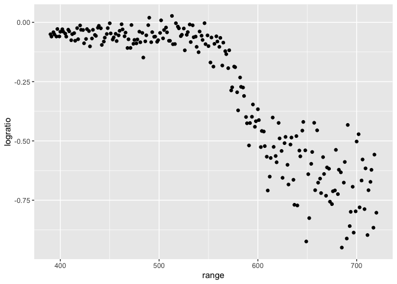
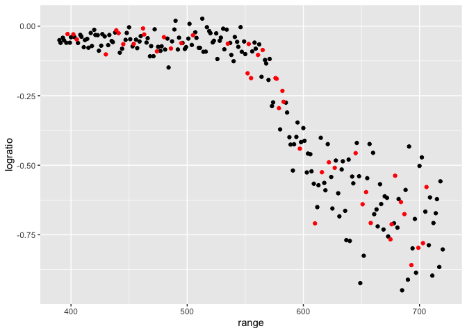
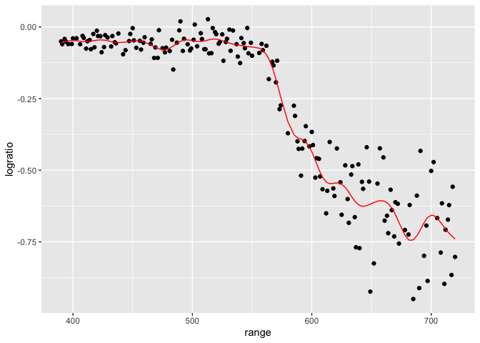
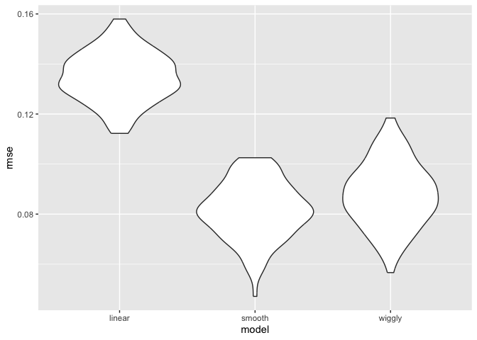

Cross Validation
================

``` r
library(tidyverse)
library(p8105.datasets)
library(modelr)
library(mgcv)
```

- In model fitting, we want consistent predictions but nothing too
  simple - something medium complexity is important for the best
  prediction accuracy.

- Random split data into training data (build model) and testing data
  (out of sample fit). Can be around 80/20 ratio (use root mean squared
  error to measure).

- So in general, helps you choose between models of varying complexity.
  Can be built into programs.

## LIDAR Data

``` r
data("lidar")

lidar_df =
  lidar |>
  mutate(id = row_number()) |>
  select(id, everything())

lidar_df |>
  ggplot(aes(x = range, y = logratio)) +
  geom_point()
```

<!-- -->

Mutate added the new column named `id` with values that are the row
numbers. `select` changes order so `id` is first from the left in the
df.

Build training and testing datasets.

``` r
train_df = sample_frac(lidar_df, size = 0.8)
test_df = anti_join(lidar_df, train_df, by = "id")
```

`size = 0.8` is the 80% fraction of the data that we’re sampling.
`test_df` term removes everything not in `train_df`.

``` r
ggplot(train_df, aes(x = range, y = logratio)) +
  geom_point() +
  geom_point(data = test_df, color = "red")
```

<!-- -->

Overlaying the two datasets, training versus testing distinction.

Fit some models.

``` r
linear_mod = lm(logratio ~ range, data = train_df)
smooth_mod = gam(logratio ~ s(range), data = train_df)
wiggly_mod = gam(logratio ~ s(range,  k = 30), sp = 10e-6, data = train_df)
```

Make a plot

``` r
train_df |>
  add_predictions(wiggly_mod) |>
  ggplot(aes(x = range, y = logratio)) +
  geom_point() +
  geom_line(aes(y = pred), color = "red")
```

<!-- -->

Adding predictions (fitted values) from linear model to training df and
then adding linear fit line/smooth model fit line.

Do a model comparison!

``` r
rmse(linear_mod, test_df)
```

    ## [1] 0.1211799

``` r
rmse(smooth_mod, test_df)
```

    ## [1] 0.07114883

``` r
rmse(wiggly_mod, test_df)
```

    ## [1] 0.08034146

- Lower `rmse` returned are better fit

## Repeat a bunch of times

Use some nice tools woo

``` r
cv_df =
  crossv_mc(lidar_df, 100)

cv_df |> pull(train) |> nth(2) |> as_tibble()
```

    ## # A tibble: 176 × 3
    ##       id range logratio
    ##    <int> <dbl>    <dbl>
    ##  1     1   390  -0.0504
    ##  2     2   391  -0.0601
    ##  3     4   394  -0.0510
    ##  4     5   396  -0.0599
    ##  5     6   397  -0.0284
    ##  6     7   399  -0.0596
    ##  7     8   400  -0.0399
    ##  8     9   402  -0.0294
    ##  9    11   405  -0.0476
    ## 10    12   406  -0.0604
    ## # ℹ 166 more rows

``` r
cv_df = 
  crossv_mc(lidar_df, 100) |>
  mutate(
    train = map(train, as_tibble),
    test = map(test, as_tibble)
  )
```

Fitting models and get rmses for these.

``` r
rmse_comp = function(model, dataset) {
  
  rmse(model, dataset)
  
}
```

``` r
cv_df = 
  cv_df |>
  mutate(
    linear_fit = map(train, \(df) lm(logratio ~ range, data = df)),
    smooth_fit = map(train, \(df) gam(logratio ~ s(range), data = df)),
    wiggly_fit = map(train, \(df) gam(logratio ~ s(range, k = 30), sp = 10e-6, data = df))
  ) |>
  mutate(
    rmse_linear = map2_dbl(linear_fit, test, rmse),
    rmse_smooth = map2_dbl(smooth_fit, test, rmse),
    rmse_wiggly = map2_dbl(wiggly_fit, test, rmse)
  )
```

- Figure out what an anonymous function is (`\(df)`)

Look at this!

``` r
cv_df |>
  select(starts_with("rmse_")) |>
  pivot_longer(
    everything(),
    names_to = "model",
    names_prefix = "rmse_",
    values_to = "rmse"
  ) |>
  ggplot(aes(x = model, y = rmse)) +
  geom_violin()
```

<!-- -->
