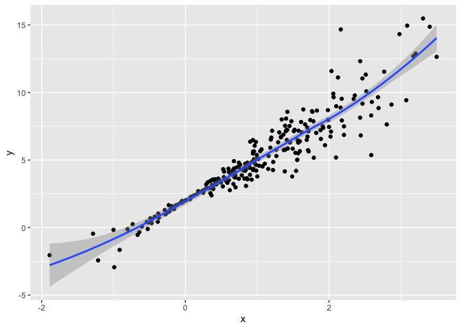
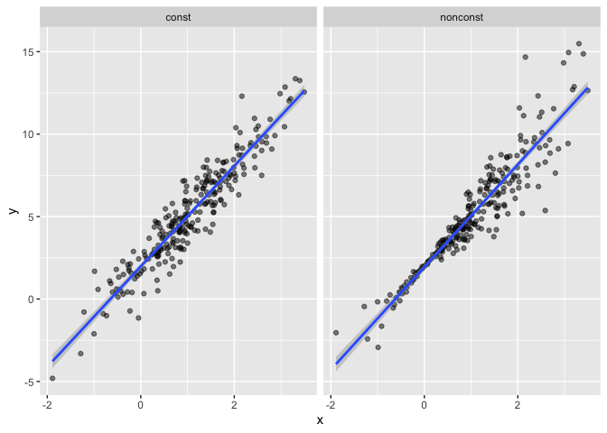
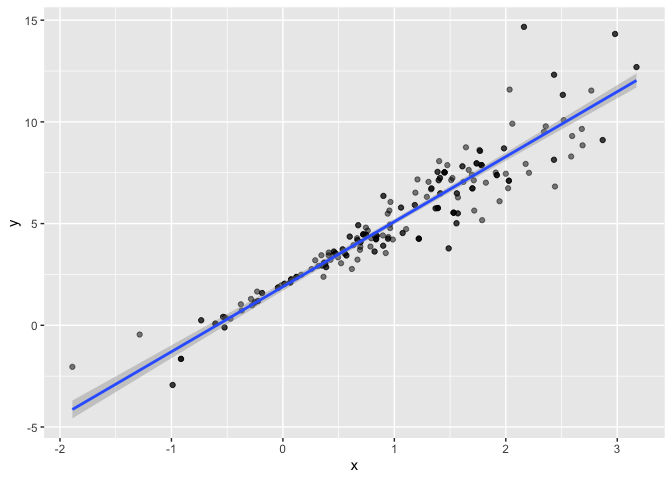
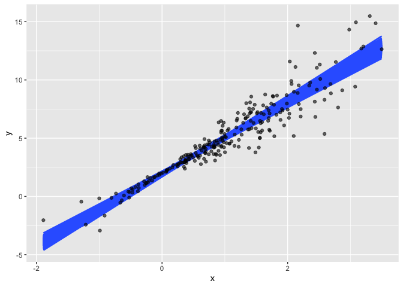
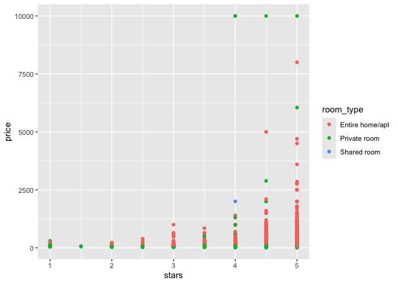
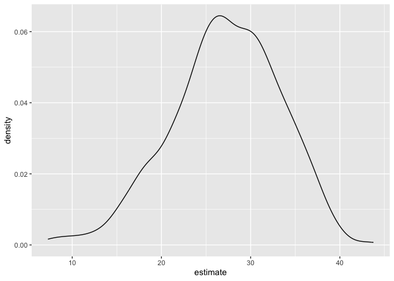
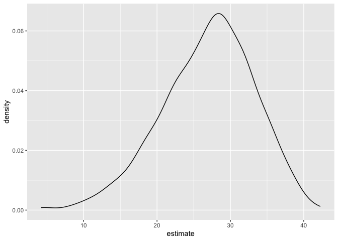

Bootstrapping
================

``` r
library(tidyverse)
library(mgcv)
library(p8105.datasets)
library(modelr)

set.seed(1)
```

# Simulated Regression

``` r
n_samp = 250

sim_df_const = 
  tibble(
    x = rnorm(n_samp, 1, 1),
    error = rnorm(n_samp, 0, 1),
    y = 2 + 3 * x + error
  )

sim_df_nonconst = sim_df_const |> 
  mutate(
  error = error * .75 * x,
  y = 2 + 3 * x + error
)
```

Plot some data

``` r
sim_df_nonconst |>
  ggplot(aes(x = x, y = y)) +
  geom_point() +
  geom_smooth()
```

    ## `geom_smooth()` using method = 'loess' and formula = 'y ~ x'

<!-- -->

``` r
sim_df = 
  bind_rows(const = sim_df_const, nonconst = sim_df_nonconst, .id = "data_source") 

sim_df |> 
  ggplot(aes(x = x, y = y)) + 
  geom_point(alpha = .5) +
  stat_smooth(method = "lm") +
  facet_grid(~data_source) 
```

    ## `geom_smooth()` using formula = 'y ~ x'

<!-- -->

Fit Regressions!

Constant:

``` r
lm(y ~ x, data = sim_df_const) |> 
  broom::tidy() |> 
  knitr::kable(digits = 3)
```

| term        | estimate | std.error | statistic | p.value |
|:------------|---------:|----------:|----------:|--------:|
| (Intercept) |    1.977 |     0.098 |    20.157 |       0 |
| x           |    3.045 |     0.070 |    43.537 |       0 |

Nonconstant:

``` r
lm(y ~ x, data = sim_df_nonconst) |> 
  broom::tidy() |> 
  knitr::kable(digits = 3)
```

| term        | estimate | std.error | statistic | p.value |
|:------------|---------:|----------:|----------:|--------:|
| (Intercept) |    1.934 |     0.105 |    18.456 |       0 |
| x           |    3.112 |     0.075 |    41.661 |       0 |

## Draw a bootstrap sample

``` r
boot_sample = function(df) {
  sample_frac(df, replace = TRUE)
}

boot_sample(sim_df_nonconst) |> 
  ggplot(aes(x = x, y = y)) + 
  geom_point(alpha = .5) +
  stat_smooth(method = "lm")
```

    ## `geom_smooth()` using formula = 'y ~ x'

<!-- -->

## Draw a bunch of samples and analyze

``` r
boot_strap_df = 
  tibble(
    strap_number = 1:1000
  ) |>
  mutate(
    strap_sample = map(strap_number, \(i) boot_sample(sim_df_nonconst)),
    model_fit = map(strap_sample, \(df) lm(y ~ x, data = df)),
    results = map(model_fit, broom::tidy)
  ) 
```

``` r
boot_strap_df |>
  unnest(results) |>
  group_by(term) |>
  summarize(
    mean_est = mean(estimate),
    se_est = sd(estimate)
  )
```

    ## # A tibble: 2 × 3
    ##   term        mean_est se_est
    ##   <chr>          <dbl>  <dbl>
    ## 1 (Intercept)     1.93 0.0747
    ## 2 x               3.11 0.101

``` r
boot_strap_df |>
  select(strap_number, strap_sample) |>
  unnest(strap_sample) |>
  ggplot(aes(x = x, y = y, group = strap_number)) +
  geom_smooth(method = "lm", se = FALSE, alpha = 0.3) +
  geom_point(data = sim_df_nonconst, aes(group = NULL), alpha = 0.6)
```

    ## `geom_smooth()` using formula = 'y ~ x'

<!-- -->

Quick notes

``` r
boot_straps = 
  sim_df_nonconst |>
  modelr::bootstrap(n = 1000)
```

## AirBnb

``` r
data("nyc_airbnb")

nyc_airbnb = nyc_airbnb |>
  mutate(
    stars = review_scores_location / 2
  ) |>
  rename(
    borough = neighbourhood_group,
    neighborhood = neighbourhood
  ) |>
  filter(borough != "Staten Island") |>
  drop_na(price, stars) |>
  select(price, stars, borough, neighborhood, room_type)
```

``` r
nyc_airbnb |>
  ggplot(aes(x = stars, y = price, color = room_type)) +
  geom_point()
```

<!-- -->

Boot strap!

``` r
airbnb_bootstrap_df =
  nyc_airbnb |>
  filter(borough == "Manhattan") |>
  modelr::bootstrap(n = 1000) |>
  mutate(
    model_fits = map(strap, \(df) lm(price ~ stars + room_type, data = df)),
    results = map(model_fits, broom::tidy)
  )
```

Are these coefficients close enough to Normal that i can trust default
inference?

``` r
airbnb_bootstrap_df |>
  select(results) |>
  unnest(results) |>
  filter(term == "stars") |>
  ggplot(aes(x = estimate)) +
  geom_density()
```

<!-- -->

``` r
nyc_airbnb |> 
  filter(borough == "Manhattan") |> 
  modelr::bootstrap(n = 1000) |> 
  mutate(
    models = map(strap, \(df) lm(price ~ stars + room_type, data = df)),
    results = map(models, broom::tidy)) |> 
  select(results) |> 
  unnest(results) |> 
  filter(term == "stars") |> 
  ggplot(aes(x = estimate)) + geom_density()
```

<!-- -->

Go back to his class notes! Did things slightly differently.

CI for stars slope

``` r
airbnb_bootstrap_df |>
  select(results) |>
  unnest(results)
```

    ## # A tibble: 4,000 × 5
    ##    term                  estimate std.error statistic   p.value
    ##    <chr>                    <dbl>     <dbl>     <dbl>     <dbl>
    ##  1 (Intercept)               75.8     18.4       4.12 3.85e-  5
    ##  2 stars                     31.4      3.81      8.24 1.80e- 16
    ##  3 room_typePrivate room   -127.       2.86    -44.5  0        
    ##  4 room_typeShared room    -153.       8.78    -17.5  1.36e- 67
    ##  5 (Intercept)               98.1     23.1       4.24 2.25e-  5
    ##  6 stars                     27.7      4.78      5.80 6.85e-  9
    ##  7 room_typePrivate room   -132.       3.65    -36.3  1.28e-276
    ##  8 room_typeShared room    -159.       9.91    -16.1  1.53e- 57
    ##  9 (Intercept)              113.      26.6       4.24 2.29e-  5
    ## 10 stars                     23.6      5.50      4.29 1.80e-  5
    ## # ℹ 3,990 more rows
